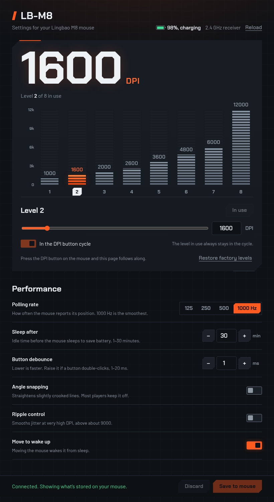

<div align="center">


# LB-M8 Settings

**The missing Linux app for the Lingbao M8 gaming mouse.**
Change DPI levels, polling rate, sleep and sensor options over USB or 2.4 GHz, right from your browser.

[](https://github.com/Muktaditbf/lingbao-m8-linux/actions/workflows/ci.yml)
[](LICENSE)
[](https://muktaditbf.github.io/lingbao-m8-linux/)



</div>

## Why this exists

Lingbao's official software for the M8 only runs on Windows. After I moved to Linux, my mouse kept working, but I couldn't change any of its settings.

So I studied the Windows driver, worked out how it talks to the mouse, and rebuilt the essential settings as a small web app. Read the full story in **[The mouse that only spoke Windows](docs/STORY.md)**.

## Features

- **DPI levels:** set all 8 levels (100–12000 in steps of 100), choose which ones the DPI button cycles through, and pick the one in use.
- **Live sync:** press the DPI button on the mouse and the page follows within a couple of seconds.
- **Performance:** polling rate (125 / 250 / 500 / 1000 Hz), sleep timer, button debounce, angle snapping, ripple control and move-to-wake.
- **Status:** battery level, charging state, and whether you're on the cable or the 2.4 GHz receiver.
- **Safe by design:** every value is checked before it's sent and read back afterwards. Nothing is written until you click **Save to mouse**, and **Discard** undoes unsaved edits.
- **No driver, no build step:** a single HTML page using [WebHID](https://developer.mozilla.org/docs/Web/API/WebHID_API). It works offline, with the fonts bundled.

## Quick start

You need a Chromium-based browser: Chrome, Edge, Brave or Chromium. Firefox doesn't support WebHID.

### Linux (recommended)

```bash
git clone https://github.com/Muktaditbf/lingbao-m8-linux.git
cd lingbao-m8-linux
./install.sh
```

The installer does two things:

1. **Device permissions.** It installs a udev rule (it asks for `sudo` once) so your browser may talk to the mouse. By default, Linux only lets root open it.
2. **App menu entry.** It adds **LB-M8 Settings** to your app menu. It opens in its own window and connects by itself once you've allowed the mouse.

Then open **LB-M8 Settings**, click **Connect mouse** and pick **LB-M8**. To undo everything: `./install.sh --remove`.

### Just try it

Open **[muktaditbf.github.io/lingbao-m8-linux](https://muktaditbf.github.io/lingbao-m8-linux/)** in a Chromium-based browser.

On Linux you still need the udev rule first:

```bash
sudo install -m644 linux/70-lingbao-lbm8.rules /etc/udev/rules.d/
sudo udevadm control --reload-rules && sudo udevadm trigger --action=add --subsystem-match=hidraw
```

## Supported devices

| Connection | USB ID | Status |
|---|---|---|
| USB cable | `b6a4:4000` | ✅ Fully tested |
| 2.4 GHz receiver | `b6a4:4001` | ✅ Fully tested |
| Bluetooth | — | ⏳ Not yet ([help wanted](https://github.com/Muktaditbf/lingbao-m8-linux/issues)) |

Tested on CachyOS (Arch-based) with KDE Plasma on Wayland and Brave. The mouse reports itself as **YXT LB-M8**, firmware 2.3. Other mice built on YXT's chips may use the same protocol. If you have one, please [open an issue](https://github.com/Muktaditbf/lingbao-m8-linux/issues/new/choose) with its `lsusb` line.

It should also work in Chrome or Edge on Windows and macOS, which don't need the udev rule, but that hasn't been tested yet.

## What it can change

| Setting | Range | Notes |
|---|---|---|
| DPI levels | 8 levels, 100–12000 DPI | Factory: 1200, 2000, 3200, 4800, 7200, 12000 |
| Polling rate | 125, 250, 500, 1000 Hz | 1000 Hz verified by timing the mouse's own reports |
| Sleep after | 1–30 min | |
| Button debounce | 1–20 ms | Lower is faster. Raise it if a button double-clicks by itself. |
| Angle snapping | on / off | |
| Ripple control | on / off | Matters above about 9000 DPI |
| Move to wake up | on / off | |

Not supported yet: button remapping, macros and lighting. The commands are known, but their data formats aren't decoded yet. LOD height can't be changed on this sensor, and the official app doesn't change it either.

## How it works

The mouse exposes a vendor-defined HID collection with a 40-byte feature report (ID 6). Every setting is a small command sent through it; reads use the same command with bit 7 set. The app is plain HTML and JavaScript:

- [`lbm8.js`](lbm8.js) holds the protocol: the packet builder, the DPI sensor table and encoders that validate every value.
- [`index.html`](index.html) is the interface and the WebHID transport.

The full byte-level reference, including what's still unknown, is in **[docs/PROTOCOL.md](docs/PROTOCOL.md)**.

## Tests

```bash
npm install
npm test                 # protocol unit tests (bytes captured from a real mouse)
npm run test:ui          # browser test with a simulated mouse: two windows, one takes over
npm run test:hardware    # full end-to-end test against a real, connected LB-M8
```

The hardware test changes every setting through the real page, checks what the mouse actually stored, then restores the original bytes. It needs the mouse plugged in, and no other LB-M8 Settings window open. Set `CHROME_PATH` to use your own browser instead of Playwright's Chromium.

To check your real polling rate, run `python3 tools/polling-rate.py` and move the mouse in circles.

## Tips for Linux

- **Turn off mouse acceleration** for 1:1 aim. In KDE: System Settings → Mouse & Touchpad → Acceleration profile → **Flat**. KDE stores this separately for the cable and the receiver, so set it once for each.
- **Only one window at a time** can talk to the mouse. Opening a second one makes the first let go. The official app has the same rule.

## Contributing

Bug reports, device reports and pull requests are welcome. See [CONTRIBUTING.md](CONTRIBUTING.md). Found a security problem? See [SECURITY.md](SECURITY.md).

## Disclaimer

This is an independent project. It is not affiliated with, endorsed by or supported by Lingbao or Shenzhen Yixintong (YXT); their names are used only to identify compatible hardware. No vendor code or files are included. The protocol was documented by studying the official driver, for interoperability.

Writing settings to your mouse is at your own risk, though every write is limited to the same values the official app can set.

## Acknowledgements

- Fonts: [Chakra Petch](https://github.com/m4rc1e/Chakra-Petch) and [Barlow](https://github.com/jpt/barlow), both under the SIL Open Font License.
- Reverse engineering with [innoextract](https://constexpr.org/innoextract/) and [Capstone](https://www.capstone-engine.org/).
- Built with [Claude Code](https://claude.com/claude-code) as my pair programmer.

## License

[MIT](LICENSE) © 2026 Muktadi
